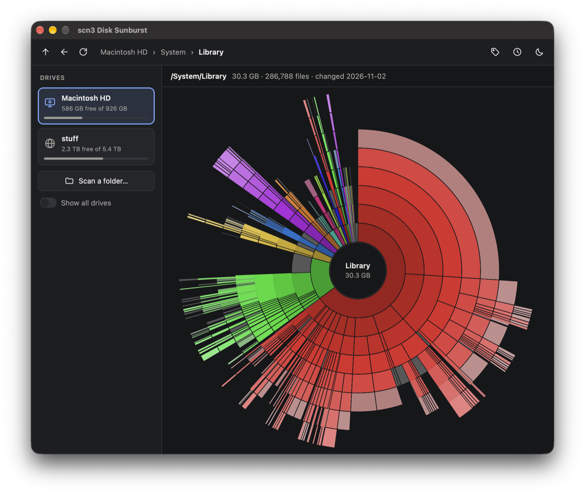
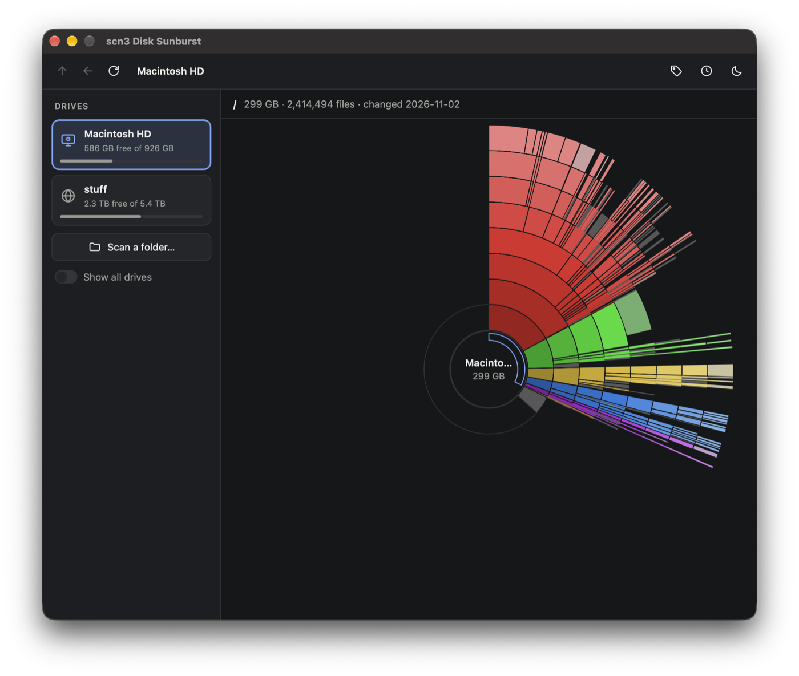
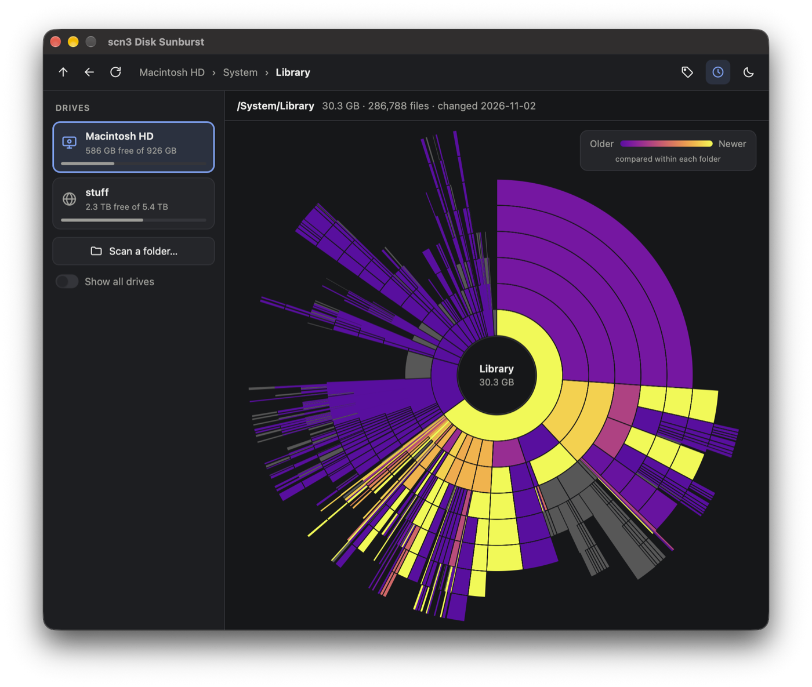

# scn3 Disk Sunburst: see what fills your disk

scn3 shows disk usage as a sunburst chart, on Windows, macOS and Linux. It is a desktop app (Go and Wails v2, with a TypeScript and Canvas UI) and a small command line tool.



<table>
  <tr>
    <td width="50%"></td>
    <td width="50%"></td>
  </tr>
  <tr>
    <td>A whole drive: used space in color, free space as the empty arc.</td>
    <td>Color by age: oldest changes purple, newest yellow, compared within each folder.</td>
  </tr>
</table>

## Features

- Parallel scan with progress and cancel.
- Sunburst chart with an arc for free space.
- Hover to see name and size.
- Click to zoom, with animation.
- Up, Back and Rescan buttons, and a breadcrumb.
- Context menu: Zoom, Open, Copy path, Rescan, Hide, Move to Trash.
- Modern look with light, dark and high-contrast themes (System follows the OS, including its "increase contrast" setting).
- Drives show an icon for their type: system, internal, external (USB, SD), network share, optical disc or disk image. Disk images, extra system volumes (such as macOS Recovery) and boot, snap and container mounts on Linux are listed only with "Show all drives" on.
- Color by age (the clock button): each file and folder is colored by its newest change, old to new (blue, yellow, red in the light theme; plasma in dark; viridis in high contrast), compared only with the items next to it in the same folder. Ages are read during every scan at no extra cost.
- Names in the chart can be turned off with the tag button.
- At a drive's root, click the band inside the center circle to see only the scanned space fill the circle, without free and not-scanned space.
- Large files show as their own segments, so they are easy to spot and move to the Trash. The folder in the center always shows its files; further out, a folder shows its files when they take up a visible part of the chart, otherwise they are an empty part of its arc.
- Drive list.
- Light and dark theme.
- Settings file.

### Keyboard and mouse

| Input | Action |
| --- | --- |
| Backspace | Up |
| Alt+Left | Back |
| F5 | Rescan |
| Enter | Zoom into the hovered item |
| Click in the center | Up |

### Settings

Settings are saved as `scn3/settings.json` in your user config directory (`os.UserConfigDir`).

## How sizes are counted

- Size on disk is used, not file length.
- A hard-linked file is counted once.
- Symlinks are not followed.
- Other mounts are not followed. On Linux this includes bind mounts and btrfs subvolumes that sit on the same device, so nothing is counted twice.
- On macOS, APFS clones of a file count once, in the folder the scan reaches first. A clone that was changed later still counts in full, so the total can be a little too high.

### The grey "not scanned" arc

This is used space on the volume that the scan did not find. For example: folders you cannot read, other volumes that share the same disk space (APFS), or filesystem overhead.

## Build and run

You need Go and Node.js (npm).

| Command | What it does |
| --- | --- |
| `make build` | Build the desktop app into `build/bin` |
| `make run` | Run the desktop app with live reload of the UI |
| `make build-cli` | Build the CLI into `bin/scan` |
| `make test` | Go tests and UI tests |
| `make vet`, `make fmt`, `make race`, `make lint`, `make vuln` | Checks |
| `make dist` | CLI binaries for all systems into `dist` (runs `vuln` first) |
| `make clean` | Remove build output |

The desktop app needs a native build on each OS. See `.github/workflows/release.yml`.

### Linux

Build packages: `libgtk-3-dev` and `libwebkit2gtk-4.1-dev`. The app needs WebKitGTK at runtime.

### Windows

The app needs WebView2.

## CLI

```
bin/scan <path> [--json] [--depth N]
```

Scans `<path>` and prints a summary. `--json` prints the tree as JSON. With `--json`, `--depth N` sets how many levels below the root are printed.

## Releases

The release workflow is `.github/workflows/release.yml`. It runs on version tags (`vX.Y.Z`) and uses the matching section of `CHANGELOG.md` as release notes.

Signing secrets are optional. Without them, builds are unsigned.

- macOS: `MACOS_CERT_P12`, `MACOS_CERT_PASSWORD`, `MACOS_SIGN_IDENTITY`, `APPLE_ID`, `APPLE_PASSWORD`, `APPLE_TEAM_ID`
- Windows: `WINDOWS_CERT_PFX`, `WINDOWS_CERT_PASSWORD`

## Contributing

Bug reports and pull requests are welcome. See [CONTRIBUTING.md](CONTRIBUTING.md). Report security problems privately, as described in [SECURITY.md](SECURITY.md).

## License

Apache-2.0. See `LICENSE`. Each release includes `THIRD_PARTY_NOTICES.txt` with the licenses of the third-party code in the binaries (all MIT, BSD or Apache-2.0).
